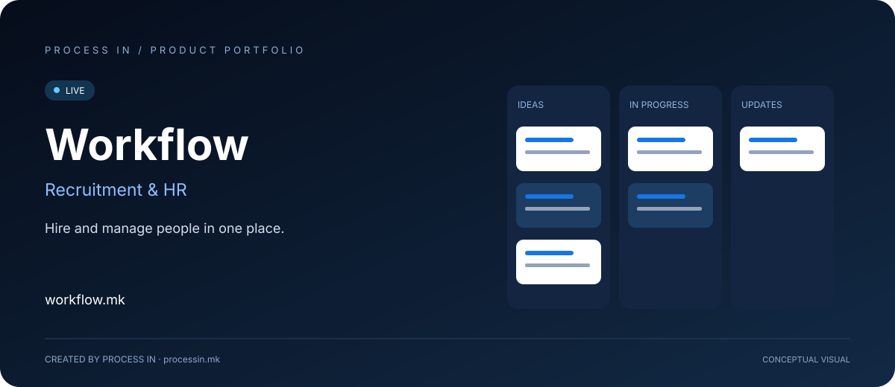

# Workflow

**Вработувај и управувај со луѓето на едно место.**

[English](README.md) · [Македонски](README.mk.md)

**LIVE**

## Поврзи го вработувањето со следниот чекор на вработениот.

Регрутацијата и HR работат на различни делови од истиот пат. Тимот за вработување следи кандидати и интервјуа; HR подготвува информации за вработениот, присуство, отсуства и воведување. Предавањето е важно бидејќи изборот кандидат е почеток на работата со вработениот.

Workflow претставува следење кандидати и HR во компаниски простор. Јавниот опфат ги поврзува фазите на регрутација со процесите по одлуката за вработување.

## Како да започнеш

| Чекор | Постапка |
|---|---|
| 01 | Создај компаниски простор |
| 02 | Отвори регрутација и HR |
| 03 | Организирај кандидати и интервјуа |
| 04 | Продолжи со процесите за вработени |

## Главни можности

| Област | Што овозможува |
|---|---|
| **Регрутација** | Организација на кандидати по фаза. |
| **Интервјуа** | Закажување и оценување. |
| **Кариерна страница** | Претставување огласи. |
| **Вработени** | Преглед на информации за вработени. |
| **Присуство и отсуства** | Присуство, смени и отсуства. |
| **Воведување** | Поврзување вработување и воведување. |

## Кому му помага и за што

| Корисник | Практична примена |
|---|---|
| **Тимови за вработување** | Организираат кандидати, интервјуа и оценување по фази. |
| **HR оддели** | Водат информации за вработени, присуство, отсуства и воведување. |
| **Компаниски администратори** | Создаваат компаниски простор и пристапуваат до регрутација и HR. |

## Конкретни ситуации на користење

### Вработување и воведување колега

Следи кандидат низ регрутација и потоа подготви информации и задачи за воведување.

### Секојдневна HR координација

Поврзи податоци за вработени, присуство и отсуства во истиот работен контекст.

## Зошто да го разгледаш решението

Практичната причина за разгледување е континуитетот. Регрутацијата објаснува како лицето доаѓа во компанијата; HR го поддржува периодот потоа. Поврзаниот простор дава заеднички контекст со различни одговорности.

## Официјални информации

| Податок | Вредност |
|---|---|
| Веб-страница | [workflow.mk](https://workflow.mk/) |
| Категорија | Регрутација и HR |
| Статус | LIVE |
| Развој | [PROCESS IN](https://processin.mk) |
| Контакт за портфолиото | [contact@processin.mk](mailto:contact@processin.mk) |

Извори за презентацијата: [1](https://workflow.mk/).

### [Посети Workflow](https://workflow.mk/)

[PROCESS IN — Your Enterprise Software & AI Partner](https://processin.mk)

---

Јавна презентација на производ. Без приватен изворен код или кориснички податоци.

This platform is a digital product of <a href="https://processin.mk" target="_blank">PROCESS IN</a> · Your Enterprise Software & AI Partner ·  
Hosted on Enterprise Infrastructure by <a href="https://inhost.mk" target="_blank">INHOST</a> ·
